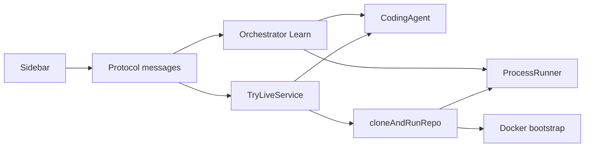

# Architecture

Devly is a pnpm monorepo. Each package has one job, and the extension host is the only place that talks to VS Code.

- `apps/extension` — VS Code extension host (esbuild bundle, CommonJS). Learn stays in `Orchestrator`. Try Live lives in `TryLiveService`.
- `apps/webview` — React sidebar (Vite). It only speaks the protocol messages.
- `packages/protocol` — Zod schemas for webview ↔ host messages.
- `packages/core` — pure domain: topic schema, recommender, prompts, lab state machine, verification, discovery. No VS Code, no `spawn`.
- `packages/agents` — `CodingAgent` adapters (Claude, Cursor, Codex, Ollama, BYOK). They run through `ProcessRunner`.
- `packages/execution` — process runner, command denylist, Docker bootstrap, workspace folders, Try Live clone-and-run.
- `packages/mascot` — Shade themes, personality lines, animation states.
- `content/` — seed catalog. Runtime reads `content/topics/index.json` and `content/categories/categories.json` only.

## Two user flows

**Learn.** User picks a topic. `WorkspaceManager` creates a lab folder and `lab.json`. `Orchestrator` walks an explicit state machine: PLANNING, WAITING_FOR_APPROVAL, GENERATING, SETTING_UP, TESTING, REPAIRING, STARTING, VERIFYING, then READY, PARTIALLY_READY, FAILED, or CANCELLED. The agent writes code. The extension runs and verifies it. The agent does not grade its own work.

**Try Live.** User confirms a GitHub repo. `cloneAndRunRepo` clones it under `~/DevlyLabs/trending` and runs Compose, Docker, Node, or Python. Common Docker failures are retried in code. If a real agent CLI is installed, it may repair the same folder twice, then write a short guide. No agent is required for a clean run.

## Rules that keep this shape

- Spawn with argument arrays. `shell: false`. The denylist rejects `sudo`, `curl|sh`, and paths outside the lab.
- Secrets are redacted before they land in logs.
- Discovery and trending caches remember their last fetch so a new editor window does not repeat the same GitHub searches.
- Docker is probed once at startup, and only if the daemon is already up and a failed lab needs cleanup.
- The published bundle is one extension. Library packages stay private to the monorepo.
